# Travel Route Planner — единое описание работы

Этот файл объединяет все 15 текстовых описаний репозитория: запуск, архитектуру, материалы участников, историю изменений, контракты и происхождение материалов. Исходные разделы сохранены ниже; их прежние имена указаны для сопоставления со старыми ссылками и журналами. Файлы с логами, JSON-контракты, исходники, изображения и лицензии остаются отдельно.

## Актуальная сводка объединения

Рабочая программа — консольный RoutePlanner в `src/`; HTTP API и графический интерфейс пока не реализованы. Запуск из корня репозитория: `python -X utf8 src/demo.py`. Тесты: `python -m unittest discover -s src -v`.

По результатам подготовки ЛР5 проверены и отрисованы 31 схема нового комплекта и 10 прежних; прошли 12 тестов backend и демонстрации ML/frontend. Зафиксирован успешный [запуск CI](https://github.com/nbrkvv/travel-route-planner/actions/runs/43835076824) для commit `5b348bab46a5f7c7ed93a424dab3e9218000e9f3`. Создан [draft PR №1](https://github.com/nbrkvv/travel-route-planner/pull/1). На момент подготовки пакета независимые review отсутствовали, слияние в main не выполнялось. Изменение документации само по себе не является новым запуском CI или ревью.

Часть разделов ниже — исторические записи этапов ML/frontend и ЛР4. Формулировки «репозиторий недоступен», «нет PR/CI» и прежние количества схем относятся к тому этапу; они не отменяют сводку выше. Пути к reference, originals и evidence описывают полный переносимый пакет, а не наличие этих материалов в публичном checkout. Старые имена Markdown-файлов в тексте обозначают разделы этого README.

Сведения о происхождении материалов сохранены; самостоятельное участие, согласование или ревью коллег не приписываются.

## Содержание

- [README.md](#document-1)
- [docs/Что_сделано.md](#document-2)
- [docs/architecture-decisions.md](#document-3)
- [docs/runtime-contracts.md](#document-4)
- [lab5/BUILD.md](#document-5)
- [lab5/REPORT.md](#document-6)
- [lab5/participants/backend/BACKEND_REPORT.md](#document-7)
- [lab5/participants/frontend/FRONTEND_REPORT.md](#document-8)
- [lab5/participants/frontend/CLIENT_CONTRACT_DRAFT.md](#document-9)
- [lab5/coordination/OPEN_ISSUES.md](#document-10)
- [lab5/coordination/CHANGELOG.md](#document-11)
- [CONTRIBUTING.md](#document-12)
- [lab5/PROVENANCE.md](#document-13)
- [lab5/participants/frontend/PROVENANCE.md](#document-14)
- [lab5/participants/ml/PROVENANCE.md](#document-15)

<a id="document-1"></a>

## Материал: README.md

### Travel Route Planner

Учебный проект ИСИТ: туристические маршруты на основе предпочтений пользователя.
Бураков совмещает роли backend-разработчика и тимлида. Команда: backend, frontend, ML.

#### Запуск кода ЛР3

Python 3.10+, без сторонних зависимостей.

```sh
cd src
python -X utf8 demo.py
python -m unittest -v
```

#### Архитектура

- `diagrams/lab1-*`: сводные L1/L2, извлечены из отчёта.
- `diagrams/lab2-components.puml`: исходный листинг L3 с добавленной оболочкой.
- `diagrams/lab3-route-planner.puml`: UML восстановлена по Python-коду, не оригинал прошлого чата.
- `diagrams/lab4/`: общие и локальные L0, динамика и развёртывание; PNG и SVG рядом.
- Изображения из старых отчётов переданы автору локальным архивом; публично не загружаются.
- Отчёт ЛР4 передан автору отдельно.
- `docs/architecture-decisions.md`, `runtime-contracts.md`: границы, решения и пошаговый сценарий.
- `validation/`: фактические логи 12 тестов, демонстрации и рендеринга 10 схем.
- `vendor/`: C4-PlantUML v2.12.0 и лицензия upstream; локальные подключения.

#### Проверка схем

Java, Graphviz и PlantUML 1.2025.2:

```sh
python scripts/render_diagrams.py --jar /path/to/plantuml.jar
```

GitHub Actions проверяет код и все диаграммы, генерирует PNG/SVG и сохраняет артефакт architecture-and-validation. При ошибке синтаксиса процесс завершается с ненулевым кодом. Файл workflow — подготовка к ЛР5 по запросу автора.

#### Статус

Реализован предметный планировщик ЛР3. API, CRM, платежная интеграция и инфраструктура ЛР4 спроектированы; они не запущены и не реализованы этим кодом. Две backend-реплики и standby БД не обеспечивают полную высокую доступность. Подробности в архитектурных решениях.

История участников и командные ревью не имитируются. Порядок будущих PR описан в CONTRIBUTING.md. Исходная методичка и персональные отчёты ЛР1–3 не публикуются. Лицензия vendor относится только к библиотеке C4.

#### ЛР5

[Сборка](#document-5), [отчёт с изображениями](#document-6), [контракты](lab5/contracts/project.json), [открытые вопросы](#document-10). Вклад коллег и утверждение контрактов не имитируются.

<a id="document-2"></a>

## Материал: docs/Что_сделано.md

### Что сделано

Изучены разделы 1.4 и матрица ролей ЛР4 методички. Созданы шесть диаграмм: общий и локальный ландшафт, общая и локальная динамика, общее и локальное развёртывание. Описаны корпоративные границы, CRM, IAM и финансовая интеграция, хронология расчёта, порты, TLS, балансировка и репликация. Сохранены границы архитектуры предыдущих работ.

Собраны листинги ЛР1 и ЛР2, изображения из трёх отчётов. L4 восстановлен по реализации. Код из RoutePlanner.zip сохранён. Все 12 тестов прошли; демонстрация воспроизводит два маршрута и ожидаемый отказ. Все 10 исходников прошли PlantUML и получили PNG/SVG. Созданы отчёт Word, документация контрактов, архитектурных решений, инструкция запуска и workflow GitHub Actions.

Бэкенд: локальные зависимости и сценарий, контракт RoutePlanner и ошибки. Тимлид: общие схемы, согласование ID и протоколов, структура репозитория и правила PR. Фактическое участие других членов команды не заявляется. Сетевые сервисы, платежи и облачное развёртывание остаются проектными решениями.

Открытый репозиторий: https://github.com/nbrkvv/travel-route-planner

Удалённая сборка успешно завершена: https://github.com/nbrkvv/travel-route-planner/actions/runs/41339495236

Артефакт architecture-and-validation содержит PNG/SVG и логи. Коммит 0be024fe6ab8213f8b266ecf373abe9743b25d44. В GitHub есть предупреждения об устаревающих версиях action, но сборка завершилась со статусом Success.

<a id="document-3"></a>

## Материал: docs/architecture-decisions.md

### Архитектурные решения ЛР4

Статус: проектирование. Производственное развертывание не выполнялось.

1. Сохранены восемь логических контейнеров ЛР1. Две backend-реплики относятся к одному контейнеру C4. Nginx является инфраструктурой. Внутренние компоненты ЛР2 не превращены в микросервисы.
2. CRM и финансовый провайдер добавлены как планируемые межсистемные интеграции для требования ЛР4. IAM уточняет существующего провайдера идентификации. В Python-прототипе этих интеграций нет. Подписка не требуется для демонстрации маршрута; платежи не входят в выбранный runtime-сценарий.
3. В ЛР1 используются ID web/mobile/api/auth/db/recommend; в ЛР2 web_app/mobile_app/route_catalog_service/auth_service/database/recommendation_service. Это алиасы одних контейнеров, а не новые сервисы. В новых файлах применяется словарь ЛР2. Отдельные уровни компилируются независимо.
4. Nginx завершает внешний TLS и повторно устанавливает TLS до backend на 8443. Приватные сервисы не публикуются в Интернет. Входящие соединения разрешены по спискам узлов. DB 5432 доступен только сервисам и репликации; S3 9000 только ML. Секреты передаются из защищенного хранилища среды развертывания, не из репозитория.
5. Балансировка backend: две stateless-реплики на разных VM, исключение нездоровых upstream. Sticky sessions не нужны. Nginx, авторизация, рекомендации и MinIO пока одиночные; полная высокая доступность не заявляется.
6. База реплицируется асинхронно. Standby не обслуживает критичные чтения маршрутов. Переключение вручную, возможна потеря неподтвержденной репликой части операций. Нужны WAL-архивирование, резервные копии и регулярная проверка восстановления; replication сама по себе не резервная копия.
7. Карточные данные вводятся у платежного провайдера. Webhook проверяется по подписи, сроку и event_id, обрабатывается идемпотентно. Эти меры являются требованиями к будущей реализации.
8. CRM получает обращение только по явному действию пользователя; карты и погода получают координаты и даты без профиля. Прикладные журналы не должны содержать токены.
9. Сетевой сервис вокруг RoutePlanner пока не реализован. Номера 1–11 общей динамики описывают проектируемый поток; шаг 7 опирается на существующий plan. Прогноз, транзакция и повторная проверка геометрии относятся к будущему прикладному слою.

<a id="document-4"></a>

## Материал: docs/runtime-contracts.md

### Сценарий построения маршрута

Общая схема нумерует вызовы 1–11; локальная добавляет передачу API → прикладной сервис и использует 1–12. Вызовы последовательные. Ответ каждой зависимости возвращается по тому же запросу. Отдельный шаг 11 общей схемы — итоговый HTTP-ответ клиенту.

1. POST /api/v1/routes: TripRequest, Bearer token, request_id. API проверяет форму входа.
2. Авторизация: токен → Principal, разрешение routes:create. 401/403 останавливают процесс до записи.
3. Репозиторий выбирает опубликованные PlaceDTO; доступные места переводятся в модель планировщика.
4. Рекомендации: кандидаты и интересы → RankedPlace. Проверяются состав ID и диапазон score [0,1]. При отказе — базовая оценка категорий с предупреждением.
5. Карты: ID, координаты, транспорт → направленная TravelMatrix; отсутствующее ребро недоступно. Отказ обязательной зависимости → 503, запись не выполняется.
6. Погода: координаты и даты → прогноз. Отказ или выход за горизонт прогноза → предупреждение без блокировки.
7. Реализованный вызов plan(candidates, preferences, matrix) → RoutePlan. NoFeasibleRoute → 422. Эвристика не гарантирует оптимальности и полноты.
8. Карты возвращают геометрию итогового пути и уточненные времена.
9. Прикладной слой повторно проверяет ограничения с уточненными временами; нарушение → 422 без сохранения.
10. Репозиторий атомарно записывает маршрут и аудит; ошибка → rollback. Только подтвержденный commit разрешает успешный ответ.
11. Клиент получает 201 RouteDTO с предупреждениями и request_id.

Проектируемые сетевые методы auth.validate_token и recommendations.rank, maps.matrix, maps.geometry, weather.forecast, repository.save_route не являются готовыми Python API. Реальная сигнатура ЛР3: RoutePlanner.plan(candidates: Sequence[RankedPlace], preferences: TripPreferences, matrix: TravelMatrix) -> RoutePlan.

Защита от повторного POST: в будущей реализации Idempotency-Key связывается с subject и хешем запроса; сохранение ключа и результата — в одной транзакции. Тайм-ауты внешних чтений ограничены, повтор записи без идемпотентности запрещён.

<a id="document-5"></a>

## Материал: lab5/BUILD.md

### Сборка ЛР5

Python 3.10+, Java 8+; CI использует Java 17. PlantUML строго 1.2025.2; C4 2.12.0 уже в vendor с лицензией. Все новые C4 — Smetana, UML L4 сохраняет оформление.

Из корня repository:
```
python -m unittest discover -s src -v
python scripts/validate_lab5.py --jar ../lab4/plantuml.jar --render
```
В рабочем checkout путь к jar: ../tools/plantuml.jar либо путь к JAR из исходного пакета. При необходимости добавьте --java с полным путём java.exe.

Проверка включает рекурсивные include, запрет внешних include/направленных Rel/локальных skinparam, уникальность ID и существование концов связей, синтаксис и PNG/SVG. Включаемые modules не компилируются отдельно. CI запускается на push/PR и сохраняет результаты. Успех рендера не доказывает семантику API.

Исторические отчёты и оригиналы участников сохраняются в корне финального пакета. Новые исходники для репозитория — repository/lab5. Индивидуальные отчёты требуют последующей пересборки участниками; статус технической подготовки не означает финальную готовность ЛР5.

<a id="document-6"></a>

## Материал: lab5/REPORT.md

### ЛР5 — технический комплект backend и интеграции

Статус: подготовлено, решения proposed и реальное review остаются открыты. Не является пересобранным Word-отчётом коллег.

#### L0

Локальная схема backend:

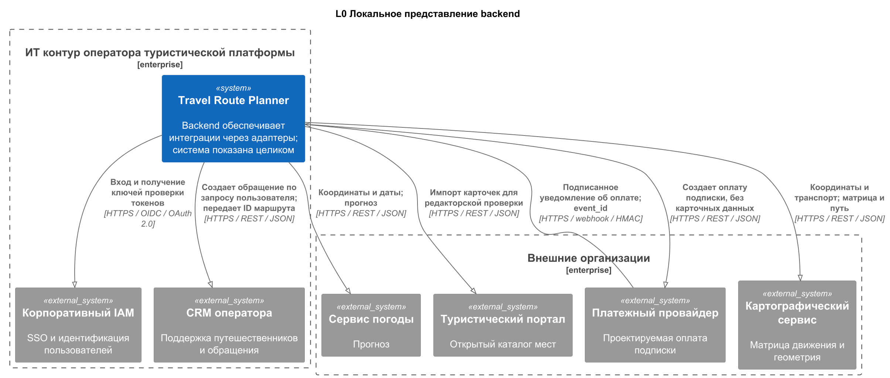

Соответствующее общее представление:

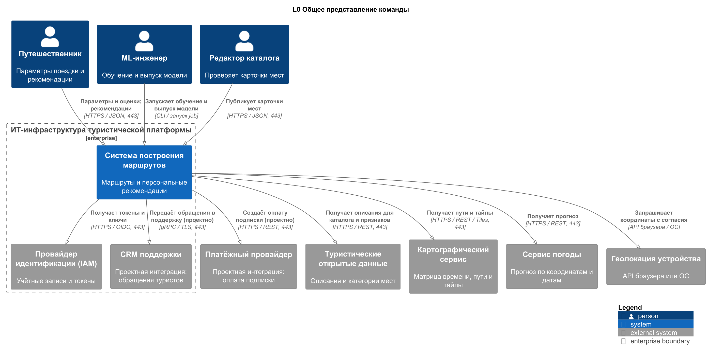

#### L1

Локальная схема backend:

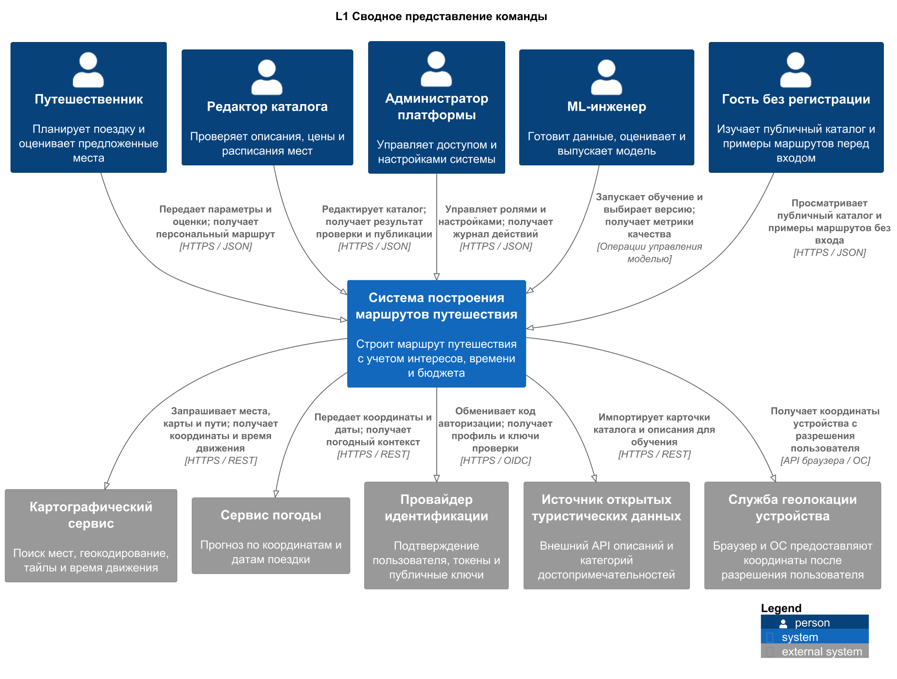

Соответствующее общее представление:


#### L2

Локальная схема backend:


Соответствующее общее представление:

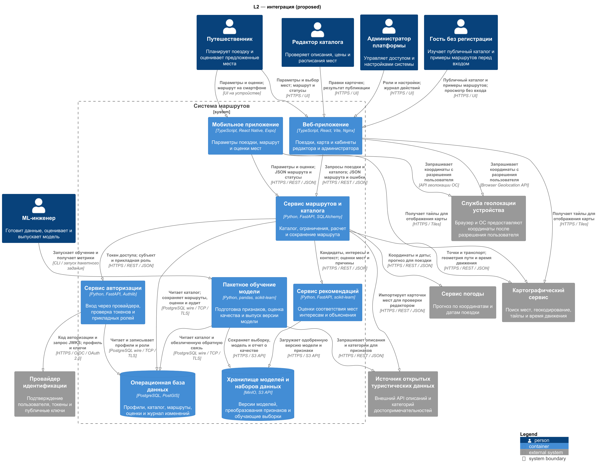

#### L3_backend

Локальная схема backend:

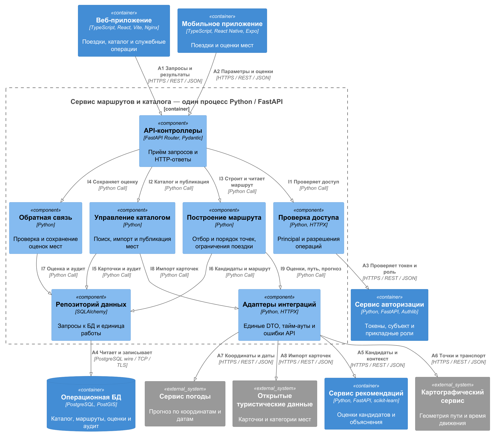

Соответствующее общее представление:


#### L4_backend

Локальная схема backend:

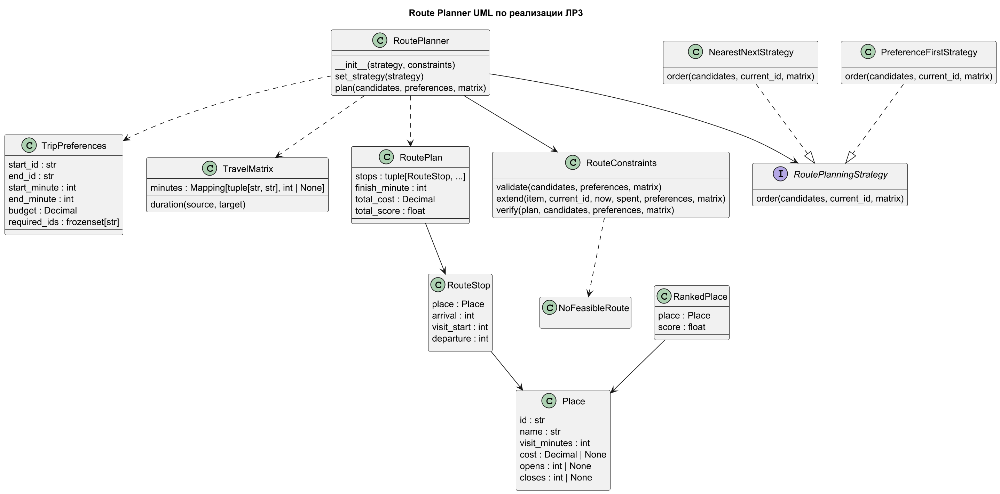

Соответствующее общее представление:


#### dynamic

Локальная схема backend:

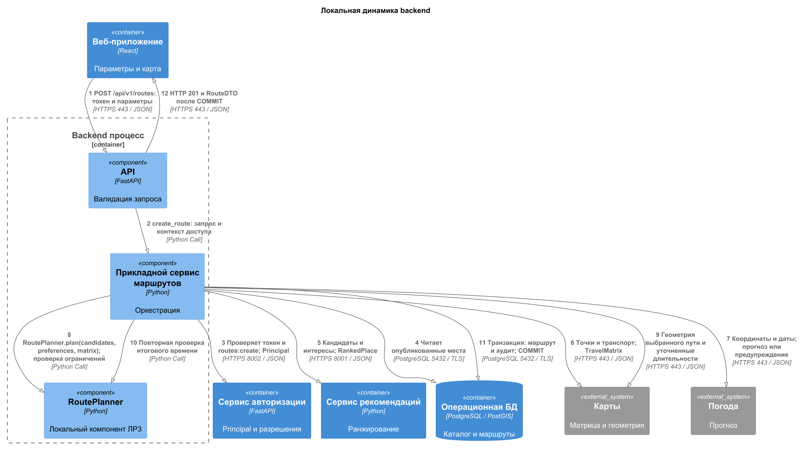

Соответствующее общее представление:

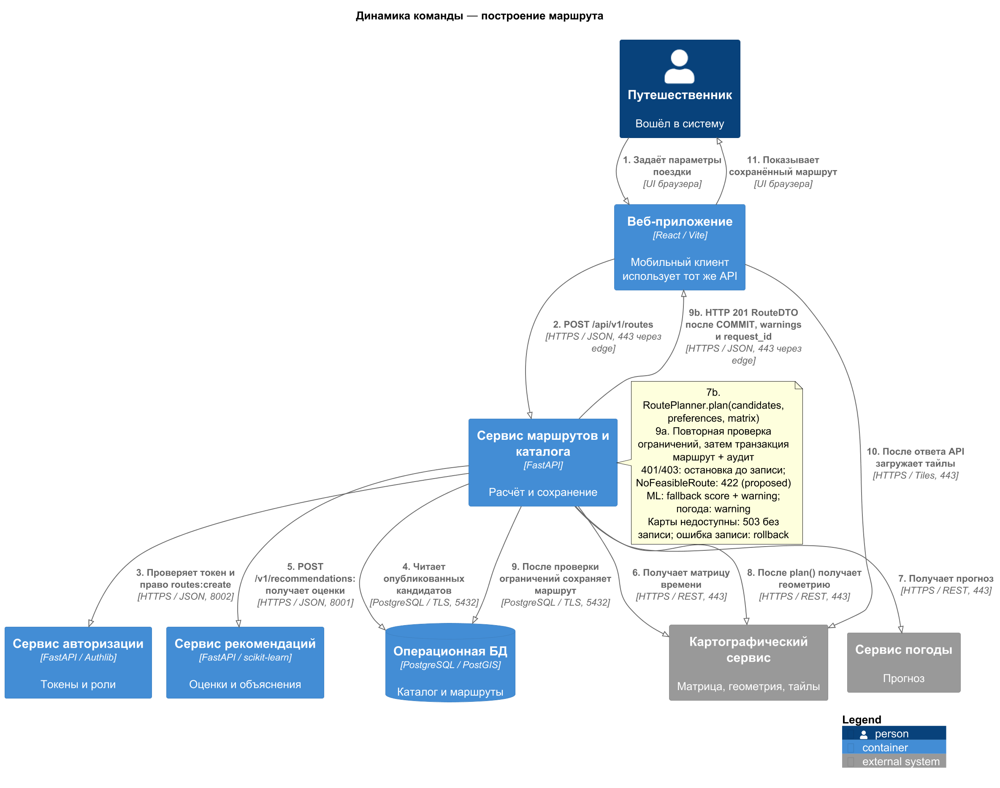

#### deployment

Локальная схема backend:

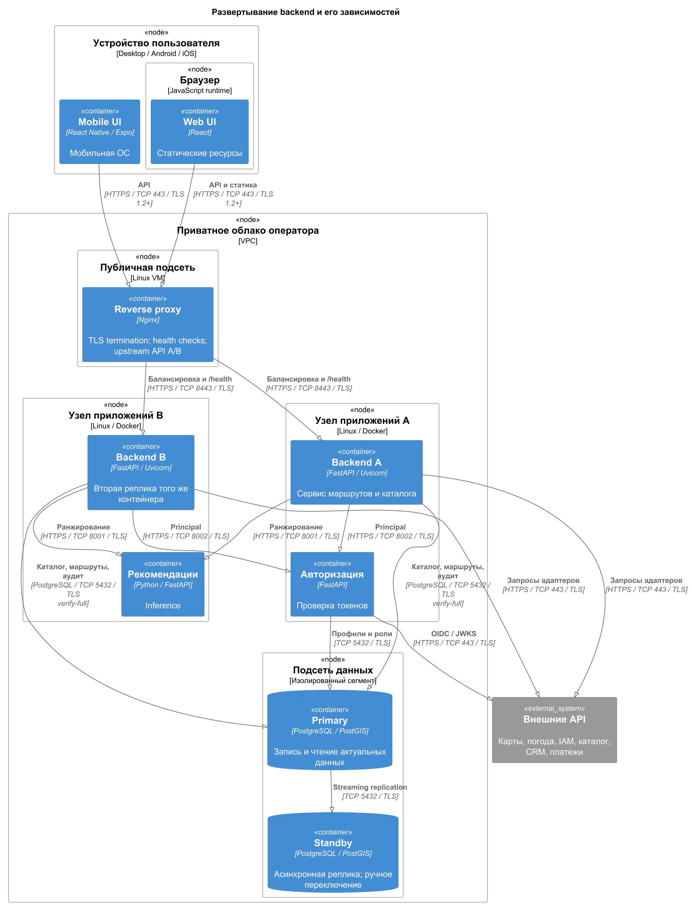

Соответствующее общее представление:

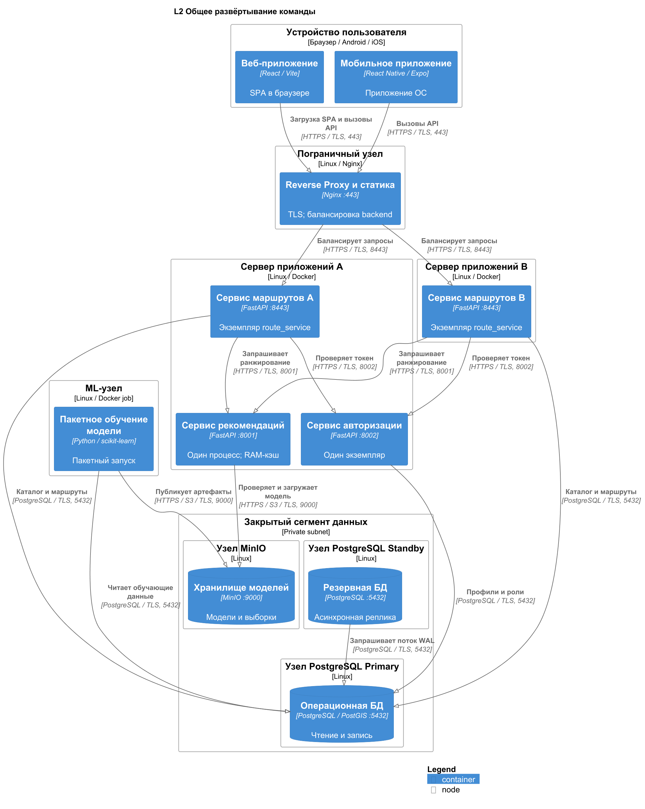

#### Представления других частей

L3 каждого контейнера — отдельный вид, чтобы не смешивать границы процессов.

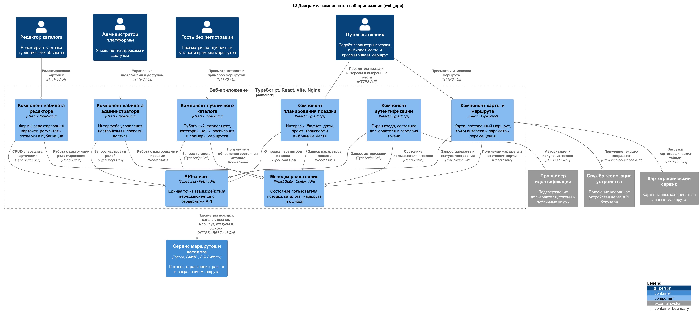

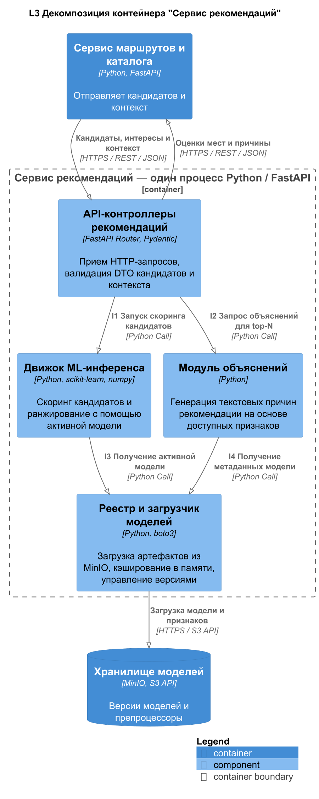

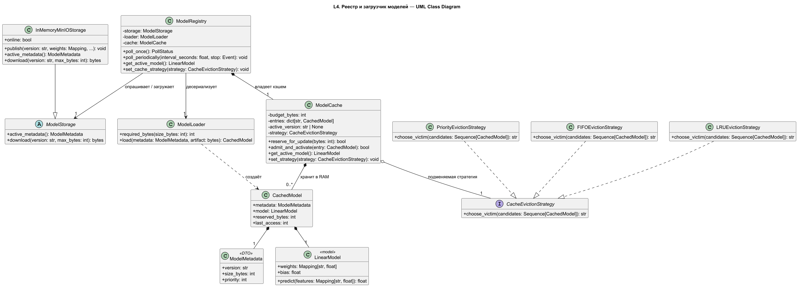

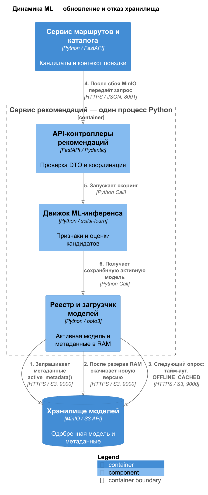

<a id="document-7"></a>

## Материал: lab5/participants/backend/BACKEND_REPORT.md

### Бураков Никита: backend и интеграция ЛР5

Вклад коллег не присваивается. Проверены входной пакет ML/frontend и текущий общий репозиторий main 0be024f. В истории доступного репозитория автор nbrkvv; это не доказательство командных PR.

Реализован только RoutePlanner и стратегии. HTTP endpoints, auth, транзакции, TLS, Idempotency-Key и клиентские DTO — проектные требования. Dataclass TripPreferences содержит start_id/end_id, минуты, Decimal budget и required_ids; преобразование координат/дат/валют из клиентского черновика ещё не реализовано. NoFeasibleRoute существует как Python exception; HTTP 422 — проектное отображение.

Интересы преобразуются ML в score; геометрия, расстояние, route_id и warnings отсутствуют в RoutePlan. Поэтому нельзя объявить frontend DTO совместимым с действующим HTTP API. Для idempotency предлагается subject+key+request hash и атомарное сохранение результата; конфликт payload требует отдельного решения.

Выбор для integrated: восемь контейнеров, четыре ML-компонента, RAM ModelCache в реестре, один edge, две реплики route, один auth и ML. CRM поддержки и подписка — proposed. Решение тимлида не заменяет подтверждение владельцами. При недоступном ML предлагается базовый скоринг с предупреждением; холодный ML без модели не ready. Карты обязательны; погода необязательна. Клиентский общий timeout 15 секунд требует распределения серверных бюджетов и отмены; это остаётся открытым.

Локальные схемы находятся в diagrams. Общие — ../../integrated. Порядок индивидуального просмотра: локальная L1 → общая L1; локальная L2 → общая L2; локальная L3 → общая L3_backend; локальная L4 → общая L4_backend; landscape-backend → L0; dynamic-backend → dynamic; deployment-backend → deployment. Старые DOCX не пересобирались и не являются финальными отчётами ЛР5.

Методичка: разделы 1.5 и 4.2–4.5 требуют интеграции, Git-участия, PR/review и сборки. Пример парковки не меняет предметную область и глобальные ID туристического проекта. Стандартный PlantUML сам не запрещает Rel_D и skinparam; это проверяет отдельный lint.

<a id="document-8"></a>

## Материал: lab5/participants/frontend/FRONTEND_REPORT.md

### Материалы участника — frontend

**Участник и роль:** Кожаринов Матвей — frontend-разработчик (web_app, mobile_app). Матвей ещё не подтвердил предложенные изменения (см. «Оставшиеся вопросы»).

**Версия входных исходников / коммит:** коммитов нет. Вход — DOCX ЛР1–ЛР4, приложенные Матвеем 15.11.2026 (хэши в PROVENANCE.md). Код клиента и репозиторий не предоставлены.

**Добавленные файлы:**
- diagrams/: L1_frontend, L2_frontend, L3_web_app, L4_trip_planner (ЛР3), L0_frontend, dynamic_frontend, deployment_frontend — .puml + .png + .svg.
- lab3_code/route_optimization.py — прототип ЛР3 без изменений.
- originals/: исходные листинги ЛР4 (извлечены из PNG), изображения ЛР1 рис. 2 и 6, изображение компонентов web_app из DOCX ЛР4.
- evidence/: DOCX ЛР2 и ЛР3 frontend (Матвей подтвердил, что все приложенные ЛР — его материалы).
- CLIENT_CONTRACT_DRAFT.md, PROVENANCE.md, validation/render_log.txt.

Порядок для индивидуального отчёта (локальная перед общей): L1_frontend → общий L1; L2_frontend → общий L2; L3_web_app (и ссылка на L3 сервиса рекомендаций из ЛР2, LR2-01); L4_trip_planner; L0_frontend → общий L0; dynamic_frontend → общая динамика; deployment_frontend → общее развёртывание. Общие схемы готовит тимлид в integrated.

**Изменения контрактов (before → after, причина, источник):**

| ID | Before | After | Причина / источник | Статус |
|---|---|---|---|---|
| API-01 | POST /api/v1/trips | POST /api/v1/routes | отчёт ЛР4 backend, базовый пакет | aligned-draft |
| NET-01 | edge → route_service HTTP/JSON :8000 | HTTPS/TLS :8443 | ЛР4 backend п.4, базовая схема 06 | aligned-draft |
| HA-01 | 2 edge (VRRP) + веб-узлы A/B :8080 | 1 edge Nginx :443 со статикой; 2 реплики route_service | базовая схема 06, ЛР4 backend п.5 | proposed |
| BUS-01 | CRM: профили, согласия, льготы; оплата билетов/экскурсий | CRM поддержки; оплата подписки (проектно) | ЛР4 backend, ЛР4 ML | proposed |
| AUTH-01 | POST /v1/tokens/verify | endpoint не указывается | contracts: auth endpoint не утверждён | proposed |
| LIB-01 | include C4_Dynamic.puml | C4_Container, номера в подписях | C4_Dynamic нет в lab4/vendor | resolved-in-package |
| ID-01 | web_spa, web/mobile/api | web_app, mobile_app, route_service | contracts.containers | proposed |
| CLOUD-01 | Yandex Cloud | провайдер не утверждён | нет в базовых схемах | proposed |

Подтверждённые документами (но не кодом) вызовы клиента — contracts/project.json → frontend_client_calls: getCurrentPosition() с таймаутом 10 с; GET /{z}/{x}/{y} к картам напрямую; POST /api/v1/routes через edge с Bearer и Idempotency-Key, таймаут 15 с; реакции на 401/422/таймаут/5xx. Поля DTO — только черновик (CLIENT_CONTRACT_DRAFT.md).

**Проверки (команда, результат, окружение):** Linux-контейнер, OpenJDK 21.0.12.1, PlantUML 1.2025.2 из lab4/plantuml.jar, Python 3 (/usr/local/bin/python3).
1. `java -jar lab4/plantuml.jar -charset UTF-8 -checkonly participants/frontend/diagrams/*.puml` → exit 0.
2. Рендер `-Sdpi=180 -tpng` и `-tsvg` для шести frontend-схем → exit 0; L4_trip_planner — отдельно (п.4) (validation/render_log.txt).
3. `python validate.py` (без --render, чтобы не перегенерировать изображения ML) → success, 20 самостоятельных диаграмм (13 прежних + 7 frontend), checkonly exit 0, демонстрация ML exit 0. Лог — validation/handoff_checks.json; прежний лог ML — validation/history/package1_ml_handoff_checks.json. Скрипт также проверил в C4-файлах smetana, отсутствие Rel_D/L/R/U, skinparam и сетевых include.
4. ЛР3: checkonly и рендер L4_trip_planner — exit 0; `python3 -I -m py_compile` — exit 0; запуск `route_optimization.py` — exit 0, вывод совпал с разделом 7 ЛР3: InterestFirst → Галерея → Музей, 2100 м, 131 мин, 950 руб.; Shortest → Парк, 800 м, 48 мин, 0 руб.; Balanced → Галерея, 1500 м, 65 мин, 350 руб. (validation/lab3_log.txt). Автотестов в ЛР3 нет.
5. Сверка PACKAGE_SHA256.json входного пакета: 79 файлов, расхождений нет.

**Компиляция и просмотр изображений:** все семь PNG просмотрены визуально: текст читается, связи и подписи соответствуют исходникам. В L2_frontend и dynamic_frontend отдельные линии проходят через подписи и границу системы, но текст остаётся читаемым; раскладку не правил, так как Rel_* и skinparam запрещены. Компиляция не проверяет работу API, TLS и балансировки — это проектная конфигурация. Word на этапе frontend не создавался.

**Реальные ссылки PR/review/CI:** нет. Ветки, коммиты, PR и запуски Actions на этом этапе не создавались. Репозиторий https://github.com/nbrkvv/travel-route-planner из среды обработки открыть не удалось — его содержимое не проверено.

**Оставшиеся вопросы:** SRC-01 (нужен код клиента или ссылка на репозиторий), LR2-01, LR3-01 (нужна ЛР2 с декомпозицией Trip Planning Service, если есть), подтверждение Матвеем HA-01 и BUS-01, AUTH-01, ERR-01, DTO-01 — см. coordination/OPEN_ISSUES.md.

**Следующему участнику требуется:** решить LR2-01/LR3-01 (какой L4 route_service идёт в integrated); сверить API-01/NET-01/DTO-01/ERR-01 с кодом и OpenAPI backend; принять или отклонить HA-01, BUS-01, CLOUD-01, ID-01; свести общие L0/L1/L2/динамику/развёртывание в integrated с учётом frontend-ID; принять PR Матвея с его схемами в репозиторий и провести ревью (Матвей должен открыть PR сам, от своей учётной записи).

<a id="document-9"></a>

## Материал: lab5/participants/frontend/CLIENT_CONTRACT_DRAFT.md

### Черновик клиентского контракта POST /api/v1/routes (frontend → backend)

Статус: **proposed**. Ни код клиента, ни код/OpenAPI backend не предоставлены, поэтому имена полей и типы ниже — проектное предложение для сверки тимлидом. Подтверждено только документами: смысл входа (интересы, бюджет, время/длительность, транспорт, стартовая точка), ответ 201 с маршрутом и предупреждениями, `request_id`, `Idempotency-Key`, коды 401/403/422/503 (ЛР4 backend), реакции клиента на 401/422/таймаут/5xx (ЛР4 frontend, табл. 3.2).

#### Запрос
`POST /api/v1/routes` через edge `https://<домен>/api/v1/routes` (443) → route_service :8443/TLS.

Заголовки: `Authorization: Bearer <token>`, `Idempotency-Key: <uuid v4>`, `Content-Type: application/json`.

Тело — имя DTO в отчёте backend: `TripRequest`. Предлагаемые поля (не подтверждены):

| Поле | Тип | Источник смысла |
|---|---|---|
| interests | string[] (ID категорий) | ЛР1, ЛР4 frontend/backend |
| budget | { amount: number, currency: "RUB" } | ЛР1; валюта RUB — из демонстрации ЛР3 backend |
| date | string (ISO 8601) | ЛР1 «даты» |
| time_window | { start: "HH:MM", end: "HH:MM" } или duration_min | ЛР4 frontend «время/длительность» |
| transport | "walk" \| "public" \| "car" | значения перечня не утверждены |
| start | { lat: number, lon: number, source: "geolocation" \| "manual" } | ЛР4 frontend шаг 2 и реакция на отказ геолокации |
| selected_place_ids | string[] (необязательно) | L3 web_app: «выбранные места» |

#### Ответ 201 (`RouteDTO` в отчёте backend)
`request_id`, `route_id`, упорядоченные остановки (id, название, координаты, время прибытия/посещения, стоимость), итоговые время, расстояние и стоимость, геометрия пути для карты, `warnings[]` (например, погода недоступна, рекомендации заменены базовой оценкой).

#### Ошибки
Предлагается единое тело `{ request_id, code, message, field_errors?: [{field, message}] }`.

| Код | Реакция клиента | Источник |
|---|---|---|
| 401 | повторный вход через IdP и повтор запроса | ЛР4 frontend |
| 403 | сообщение о недостатке прав, без повтора | предложение |
| 422 `validation_error` | ошибки на полях формы, значения сохраняются | ЛР4 frontend |
| 422 `no_feasible_route` | предложить ослабить бюджет или время | ЛР4 frontend + backend (NoFeasibleRoute → 422) |
| 503 / 5xx / таймаут 15 с | сообщение и кнопка повтора с тем же Idempotency-Key | ЛР4 frontend + backend |

Вопрос к backend (ERR-01): оба случая 422 должны различаться полем `code`, иначе клиент не выберет реакцию.

<a id="document-10"></a>

## Материал: lab5/coordination/OPEN_ISSUES.md

### Открытые вопросы

Статусы: **pending** — не решено; **proposed** — подготовлен один вариант, требуется подтверждение участника/команды; **aligned-draft** — файлы frontend синхронизированы с базовым вариантом, но реализация не проверена; **resolved-in-package** — техническая правка внутри пакета, смысл не меняет. Отсутствие ответа не означает согласия.

| ID | Расхождение | Рабочее решение | Статус после этапа frontend | Кто проверяет |
|---|---|---|---|---|
| API-01 | /api/v1/trips у frontend против /api/v1/routes у backend | Новые схемы и contracts frontend используют POST /api/v1/routes. Код клиента не предоставлен, поэтому изменение затрагивает только документацию; оригинал — в participants/frontend/originals | aligned-draft; ждёт подтверждения кодом/OpenAPI backend | backend |
| NET-01 | HTTP:8000, HTTPS:8443 и mTLS:8000 в разных отчётах | deployment_frontend: edge → route_service HTTPS/TLS 8443 (как у backend и ML); исходный HTTP:8000 сохранён в originals | aligned-draft | backend |
| HA-01 | Два edge (VRRP) и веб-узлы A/B у frontend, один edge со статикой в базовой схеме | Предложение frontend: принять базовый вариант — один edge Nginx раздаёт статику и балансирует две реплики route_service; ограничение HA (edge — единая точка отказа) указать в общей схеме. Альтернатива (2 edge + VRRP) сохранена в originals и может быть возвращена решением тимлида | proposed; требует подтверждения Матвея и тимлида | frontend, lead |
| HA-02 | Две реплики auth/ML в старой ML-версии и одна в backend | Не относится к frontend; не изменялось | pending | ml, lead |
| BUS-01 | Разные назначения CRM и платежей | В L0_frontend принят базовый вариант: CRM поддержки (обращения), оплата подписки — оба проектно. Исходный вариант frontend (профили/согласия/льготы; билеты и экскурсии) сохранён в originals | proposed; требует подтверждения Матвея и решения тимлида | frontend, lead |
| DTO-01 | Полные схемы JSON не подтверждены | Подготовлен клиентский черновик participants/frontend/CLIENT_CONTRACT_DRAFT.md (TripRequest/RouteDTO, заголовки, ошибки) | proposed; ждёт кода/OpenAPI backend | backend |
| CI-01 | В отчёте backend заявлены GitHub и workflow, но удалённая сборка не проверена | На этапе frontend репозиторий https://github.com/nbrkvv/travel-route-planner открыть не удалось (адрес недоступен из среды обработки); PR и CI не создавались | pending | lead |
| SRC-01 | Нет исходного кода web_app/mobile_app и доступа к репозиторию клиента | Вызовы клиента подтверждены только проектными документами ЛР1/ЛР4. Нужен код клиента или ссылка на репозиторий | pending (вопрос задан Матвею) | frontend |
| AUTH-01 | L3 web_app: компонент аутентификации обращается к IdP по OIDC; L2: обмен кода и JWKS выполняет auth_service; ЛР4 frontend: Authorization Code + PKCE в клиенте; условный endpoint POST /v1/tokens/verify | Предложение: браузер выполняет front-channel редирект на IdP (PKCE), обмен кода и проверку токена выполняет серверная часть (auth_service); имя endpoint проверки не фиксировать до решения backend. В новых схемах endpoint удалён | proposed | frontend, backend |
| ERR-01 | Один код 422 для ошибки валидации и NoFeasibleRoute | Ввести поле code в теле ошибки (validation_error / no_feasible_route) | proposed | backend |
| ID-01 | Алиасы curator/catalog_editor, admin/platform_admin, open_data/tourism_data, geolocation/device_location, web_spa/web_app | Канон — таблицы глоссария ЛР1 и contracts; таблица element_aliases добавлена в contracts. Файлы ML не переименовывались | proposed (простое переименование для integrated) | lead |
| LIB-01 | ЛР4 frontend подключал C4_Dynamic.puml, которого нет в общей библиотеке lab4/vendor | dynamic_frontend переписан на C4_Container с номерами в подписях, как у ML; стиль не менялся. Если нужна автонумерация, тимлид добавляет C4_Dynamic.puml из тега v2.12.0 | resolved-in-package | lead |
| CLOUD-01 | ЛР4 frontend указывал Yandex Cloud; в базовых схемах провайдер не назван | В deployment_frontend — «облачная VPC, провайдер не утверждён» | proposed | lead |
| LR2-01 | ЛР2 frontend по тексту и листингу совпадает с ЛР2 ML (L3 recommendation_service). Своей L3 для web_app/mobile_app в ЛР2 нет | Матвей подтвердил, что ЛР2 — его материал. Повторная .puml не создавалась. Предложение: в отчёте frontend как собственный L3 показывать L3_web_app.puml (из DOCX ЛР4), а ЛР2 — ссылкой на общую L3 сервиса рекомендаций. Вопрос авторства/дублирования решают Матвей и тимлид | proposed | frontend, lead |
| LR3-01 | ЛР3 frontend детализирует TripPlanner в «Trip Planning Service» с компонентами API Controller, Preference Processing, Trip Planner, External Data Adapter, Route Repository и сигнатурой build_trip(criteria) → TripPlan. Это зона route_service (backend), где ЛР3 backend даёт RoutePlanner.plan(candidates, preferences, matrix) → RoutePlan с двумя стратегиями. Ссылки «I2–I5 ЛР2» в ЛР3 не соответствуют приложенной ЛР2 (там I1–I4 сервиса рекомендаций) | Добавлены L4_trip_planner.puml и route_optimization.py без изменений; Trip Planning Service записан алиасом route_service (proposed). Предложение: L4 route_service в integrated — RoutePlanner backend; TripPlanner frontend — индивидуальная L4 с явной пометкой «альтернативный прототип того же компонента». Нужна ЛР2 с декомпозицией Trip Planning Service, если она есть | proposed; вопрос задан Матвею | frontend, backend, lead |
| VER-01 | Изображения ЛР4 frontend сделаны PlantUML 1.2024.7, dpi 220, без Smetana | Новые изображения frontend сгенерированы PlantUML 1.2025.2, Smetana, dpi 180; старые сохранены как evidence | resolved-in-package | — |

#### Результат проверки backend v3
API-01: resolved as design alignment, не реализованный endpoint. NET-01: resolved-in-package для подписей 443/8443/8002/8001, конфигурация TLS pending. ID-01: resolved-in-package в integrated. CI-01: репозиторий доступен через GitHub, новый PR/CI фиксируются отдельно. DTO-01, ERR-01, AUTH-01, HA-01/02, BUS-01, CLOUD-01, LR2-01, LR3-01 остаются proposed; SRC-01 pending. Нужны реальные клиентские исходники, решение владельцев о DTO/PKCE/репликах и индивидуальные PR/review.

<a id="document-11"></a>

## Материал: lab5/coordination/CHANGELOG.md

### Журнал передачи

#### Пакет 1 — ML
Подготовлены исходники и отчёт ML, правила стыковки, референсы и список спорных решений. Командное согласование и удалённая CI не подтверждены. Из документов восстановлены L3, L4 и Python-прототип; переносы строк внутри строковых литералов L3 объединены, сетевое подключение C4 заменено локальным. L1/L2 перенесены из сохранённого комплекта ЛР1 с изменением только пути библиотеки.

#### Пакет 2 — frontend
Матвей ещё не подтвердил proposed-пункты. Предыдущие материалы сохранены без изменений, кроме coordination/*, contracts/project.json, validation/handoff_checks.json (перезаписан validate.py; прежний — validation/history/package1_ml_handoff_checks.json), PACKAGE_SHA256.json и строки START_HERE.md о текущем этапе.

Добавлено в participants/frontend: шесть локальных схем (L1, L2, L3 web_app, L0, динамика, развёртывание) с PNG/SVG, originals (листинги ЛР4 из метаданных PNG, рисунки ЛР1), evidence (приложенные ЛР2/ЛР3), CLIENT_CONTRACT_DRAFT.md, PROVENANCE.md, FRONTEND_REPORT.md.

Before → after:
- API-01: POST /api/v1/trips → POST /api/v1/routes (frontend-схемы, contracts). Основание — ЛР4 backend. Код не проверен.
- NET-01: edge → route_service HTTP :8000 → HTTPS/TLS :8443.
- HA-01 (proposed): 2 edge + веб-узлы A/B → 1 edge со статикой, 2 реплики route_service.
- BUS-01 (proposed): CRM профилей/льгот и оплата билетов → CRM поддержки и оплата подписки.
- AUTH-01 (proposed): условный POST /v1/tokens/verify удалён из схем.
- LIB-01: C4_Dynamic → C4_Container с номерами в подписях (общая библиотека, стиль не менялся).
- contracts: frontend_alignment, frontend_client_calls, frontend_components, element_aliases, infrastructure_alignment_frontend; status дополнен «frontend_prepared».
- OPEN_ISSUES: статусы API-01, NET-01, HA-01, BUS-01, DTO-01, CI-01 обновлены; добавлены SRC-01, AUTH-01, ERR-01, ID-01, LIB-01, CLOUD-01, DOC-01, VER-01.

Дополнение после уточнения Матвея («все приложенные ЛР — со стороны frontend»): ЛР2/ЛР3 перенесены в evidence как frontend; добавлены L4_trip_planner.puml (листинг А ЛР3 без изменений) с PNG/SVG и lab3_code/route_optimization.py (листинг Б без изменений); DOC-01 заменён на LR2-01 и LR3-01; в contracts добавлены frontend_individual_l4, frontend_lab2 и алиас trip_planning_service → route_service.

Фактически проверено: PlantUML 1.2025.2 checkonly и рендер PNG/SVG семи frontend-схем — exit 0; validate.py без --render — success, 20 диаграмм; демонстрация ML — exit 0; py_compile и запуск прототипа ЛР3 frontend — exit 0, вывод совпал с отчётом; визуальный просмотр шести PNG; сверка хэшей входного пакета — 79/79. Не проверено: код клиента и backend, OpenAPI, GitHub-репозиторий (недоступен из среды), PR, ревью, удалённая CI. Изображения ML не перегенерировались.

#### Пакет 3 — тимлид
Заполняет тимлид: решения, общая сборка, реальные PR и CI.

##### Фактические проверки пакета 1
13 самостоятельных диаграмм прошли проверку синтаксиса и генерацию PNG/SVG; демонстрация Python ЛР3 завершилась успешно. Это локальная проверка упаковки, не удалённая CI и не ревью коллег. Исторические UML L4 сохранены со своим движком по исходнику; C4 использует Smetana.

#### v3 backend_and_lead — 2026-11-16
- До: репозиторий и API не проверены. После: main 0be024f совпадает с GitHub; реализован только доменный планировщик. DTO остаются proposed.
- До: auth/ML в backend-схемах 8443. После: 8002/8001 по предложению общего contracts, сетевых сервисов нет. Затронуты diagrams/lab4 и новые lab5/participants/backend.
- До: разрозненные ID и полные схемы. После: canonical ID в integrated; L2 собирается из трёх include-фрагментов. Старые материалы участников сохранены.
- Самостоятельные L0–L4, динамика, обновление модели, deployment; единая библиотека vendor. L4 сохраняет оформление.
- Исходные DOCX — исторические evidence, не обновлённые отчёты ЛР5.

<a id="document-12"></a>

## Материал: CONTRIBUTING.md

### Работа команды

Бураков совмещает backend и тимлида; frontend и ML отвечают за свои части. Создавайте feature-ветку, меняйте файлы своей зоны и открывайте Pull Request в main. Тимлид проверяет ID, границы C4, контракт и протокол каждой связи, соответствие L2/L3/L4 и успешную автоматическую сборку. Изменения интерфейсов согласуются с владельцем второй стороны.

Схемы в diagrams являются самостоятельными точками сборки. Повторяющиеся элементы внутри разных уровней не следует объединять в одну диаграмму. Общие библиотеки находятся в vendor.

История, PR и ревью других участников не воспроизводятся искусственно. Текущая поставка собирает предоставленные материалы одним автором; реальное командное участие должно происходить в дальнейшем.

<a id="document-13"></a>

## Материал: lab5/PROVENANCE.md

### Происхождение и авторство

Исходные материалы ML приписаны Дадонову Дмитрию согласно пакету; frontend — Кожаринову Матвею. Это происхождение материалов, а не заявление об их Git-коммитах или согласовании. Восстановленная frontend L3 сохраняет исходное предупреждение о назначенных ID.

Код и схемы backend взяты из существующего main 0be024f. Репозиторий не создавался заново. Имеющийся пользовательский неотслеживаемый docs/Что_сделано.md оставлен без изменений и не включён в commit. Материалы reference и персональные DOCX не публикуются. C4 vendor сохраняет LICENSE; лицензия на весь проект не назначается автоматически.

integrated — новые производные схемы, подготовленные одним исполнителем. Они не заменяют индивидуальные PR коллег. Старые Word-отчёты — evidence прошлых ЛР; новая архитектура в них не отражена. Финальная готовность до настоящего review и удалённой сборки не заявляется.

<a id="document-14"></a>

## Материал: lab5/participants/frontend/PROVENANCE.md

### Происхождение frontend-материалов (этап 2 пакета)

Входные материалы, приложенные Кожариновым Матвеем к запросу (SHA-256, первые 16 знаков):
```
00e033497f96a1b3…  4e0689dd-____1_______________________________.docx
791822a9c0643356…  ab0fcd44-____2_______________.docx
0650c9f4741d0ab2…  adb1baed-____3_______________.docx
e67029e082aa219a…  e21cc071-__4________________1.docx
```
- ЛР1 (4e0689dd…) побайтно совпадает с reference/lab1_team.docx — повторно не вкладывалась.
- ЛР4 frontend (e21cc071…) побайтно совпадает с reference/lab4_frontend_input.docx — повторно не вкладывалась.
- ЛР2 (ab0fcd44…) и ЛР3 (adb1baed…) — evidence/frontend_lab2.docx и frontend_lab3.docx. По словам Матвея (15.11.2026), все четыре приложенные ЛР — материалы frontend.
- ЛР2: текст и листинг А.1 по содержанию совпадают с ЛР2 ML (reference/lab2_ml.pdf, participants/ml/diagrams/L3_recommendations.puml). Отличаются только пробелы и строка include (в DOCX — сетевой master-URL). Поэтому отдельная .puml не создавалась, чтобы не дублировать L3 ML. Листинг сохранён в originals/lab2_lab3/lab2_recommendations_listingA1.puml.txt (LR2-01).
- ЛР3: L4 TripPlanner (Strategy, 3 стратегии) — диаграмма diagrams/L4_trip_planner.puml (листинг приложения А без изменений, исходное UML-оформление) и код lab3_code/route_optimization.py (листинг приложения Б без изменений). Копии листингов — originals/lab2_lab3/. Расхождения с backend — LR3-01.
- Код web_app/mobile_app и доступ к репозиторию не предоставлены (SRC-01).

| Новый файл (diagrams/) | Основание | Что изменено относительно основания |
|---|---|---|
| L4_trip_planner.puml | Приложение А ЛР3 frontend | Без изменений; рендер штатным UML-движком (Graphviz), как у L4 ML |
| lab3_code/route_optimization.py | Приложение Б ЛР3 frontend | Без изменений; извлечён из DOCX (замена HTML-сущностей и неразрывных пробелов) |
| L1_frontend.puml | Рисунок 2 ЛР1 (originals/lab1_fig2_L1_frontend.png); исходник .puml отсутствовал | Транскрипция изображения; ID по глоссарию ЛР1; добавлены pragma smetana и локальный include |
| L2_frontend.puml | Рисунок 6 ЛР1 (originals/lab1_fig6_L2_frontend.png) | Транскрипция; ID контейнеров по contracts (web→web_app и т.д.); 16 связей как на рисунке |
| L3_web_app.puml | Изображение «Диаграмма компонентов веб-приложения» внутри DOCX ЛР4 (originals/lab4/web_app_components_lab4_docx_image2.png, …image3.svg); в тексте отчёта ЛР4 оно не описано | Транскрипция текста SVG и стрелок PNG; ID web_*_comp назначены заново (proposed); стиль заменён на общую библиотеку C4 |
| L0_frontend.puml | Листинг А.1 ЛР4; исходник подтверждён метаданными PNG отчёта (originals/lab4/L0_frontend.puml.txt) | BUS-01: CRM поддержки и оплата подписки (proposed); порты 443; smetana |
| dynamic_frontend.puml | Листинг А.2 ЛР4 (originals/lab4/dynamic_route_build.puml.txt) | API-01: /api/v1/routes; удалён условный POST /v1/tokens/verify (AUTH-01); добавлены Idempotency-Key, порты 443/8002/8001/5432; C4_Dynamic → C4_Container с номерами в подписях (LIB-01) |
| deployment_frontend.puml | Листинг А.3 ЛР4 (originals/lab4/deployment_frontend.puml.txt) | NET-01: 8443/TLS; HA-01: один edge со статикой, две реплики route_service (proposed); web_spa→web_app; Yandex Cloud → провайдер не утверждён (CLOUD-01) |

Файлы originals/lab4/*.puml.txt извлечены из блока iTXt «plantuml» PNG-рисунков отчёта ЛР4 (PlantUML 1.2024.7). Первая строка «skinparamlocked dpi 220» добавлена генератором при рендере, а не автором. Расширение .txt исключает их из проверки validate.py: они подключают C4_Dynamic.puml, которого нет в общей библиотеке.

<a id="document-15"></a>

## Материал: lab5/participants/ml/PROVENANCE.md

### Происхождение ML-материалов

ЛР4: новый отчёт и семь проверенных схем из предыдущего этапа работы; командное утверждение не заявляется.
L1_ml/L2_ml и исторические integrated-файлы: сохранённый комплект Travel_Lab1_New; изменены только относительные пути include. Исторические integrated здесь — evidence ЛР1, не итог ЛР5.
L3_recommendations: листинг приложения А PDF ЛР2; объединены переносы внутри строк и заменён master-URL на локальную C4 2.12.0.
L4_model_registry: листинг приложения В DOCX ЛР3; исходные UML-настройки сохранены.
model_registry.py и demo.py: листинги А/Б DOCX ЛР3. В примере MinIO заменён эмулятором. Новые свойства потокобезопасности или реального S3 не заявляются.
Список исходных документов и соответствующие файлы находятся в reference.
