# ЛР5 — технический комплект backend и интеграции

Статус: подготовлено, решения proposed и реальное review остаются открыты. Автор изменений: ИИ по поручению Буракова Никиты. Не является пересобранным Word-отчётом коллег.

## L0

Локальная схема backend:

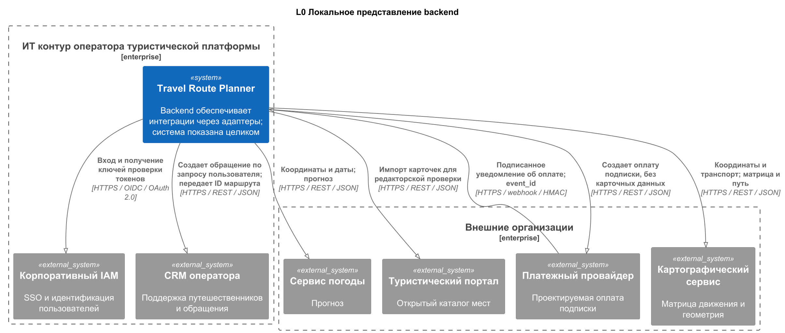

Соответствующее общее представление:

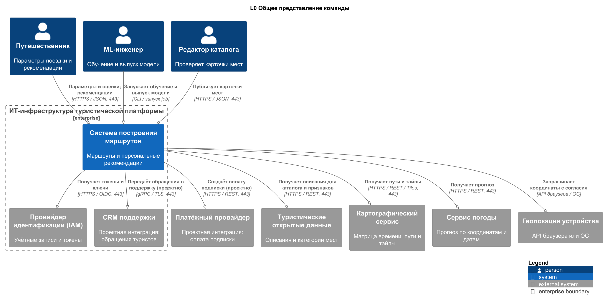

## L1

Локальная схема backend:

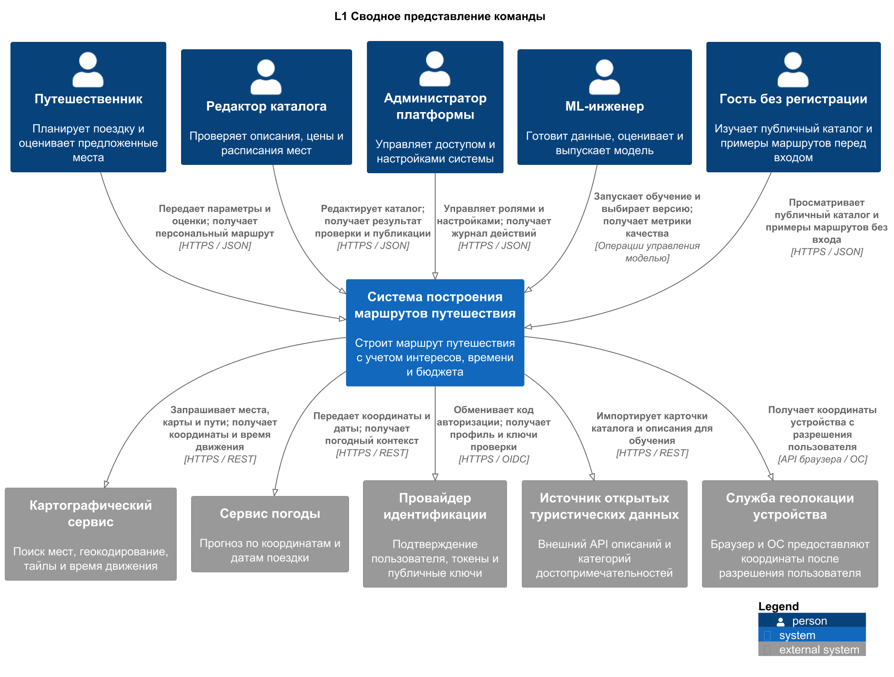

Соответствующее общее представление:

## L2

Локальная схема backend:

Соответствующее общее представление:

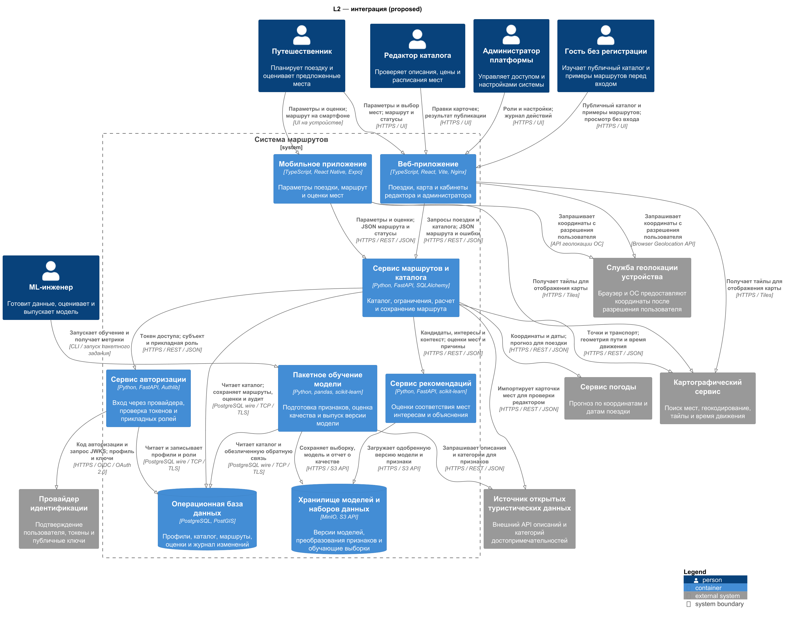

## L3_backend

Локальная схема backend:

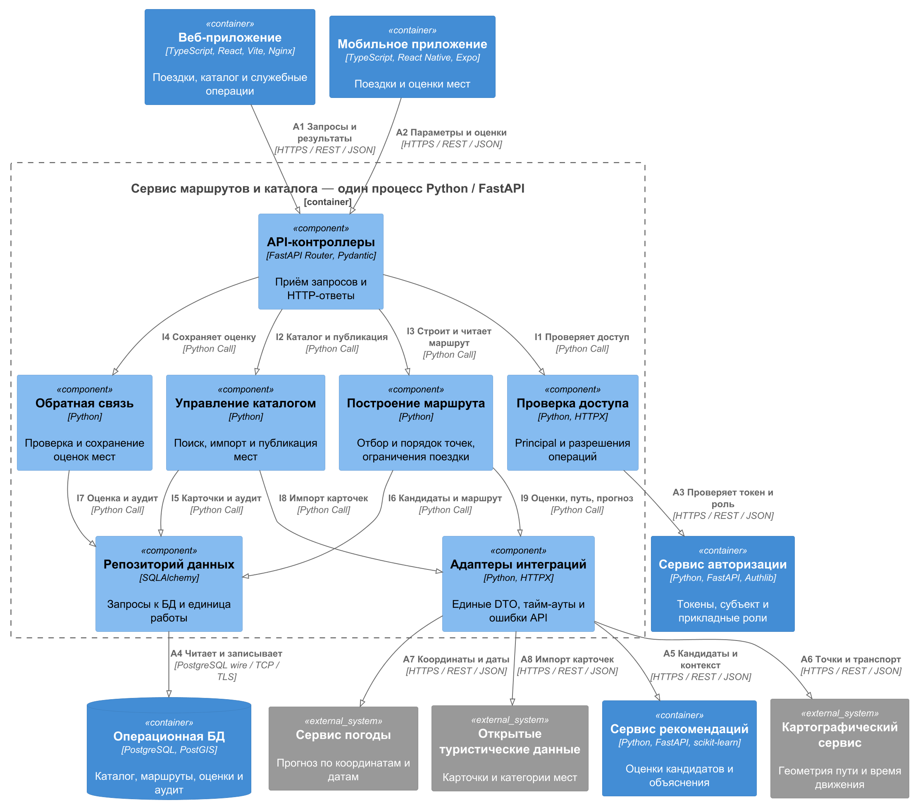

Соответствующее общее представление:

## L4_backend

Локальная схема backend:

Соответствующее общее представление:

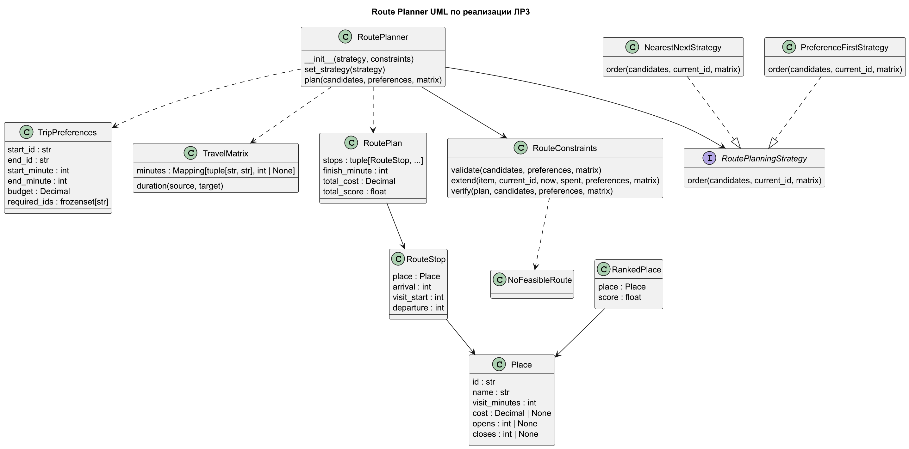

## dynamic

Локальная схема backend:

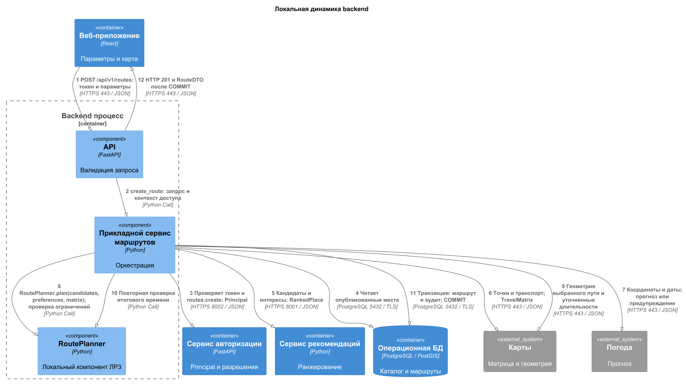

Соответствующее общее представление:

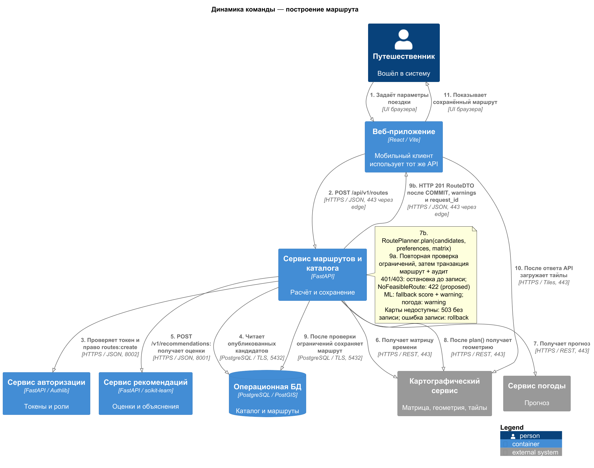

## deployment

Локальная схема backend:

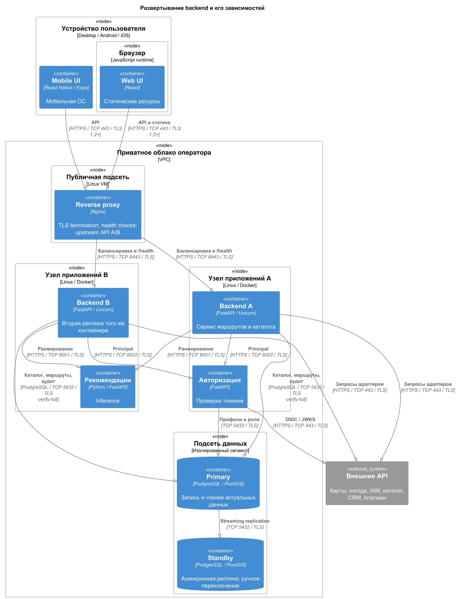

Соответствующее общее представление:

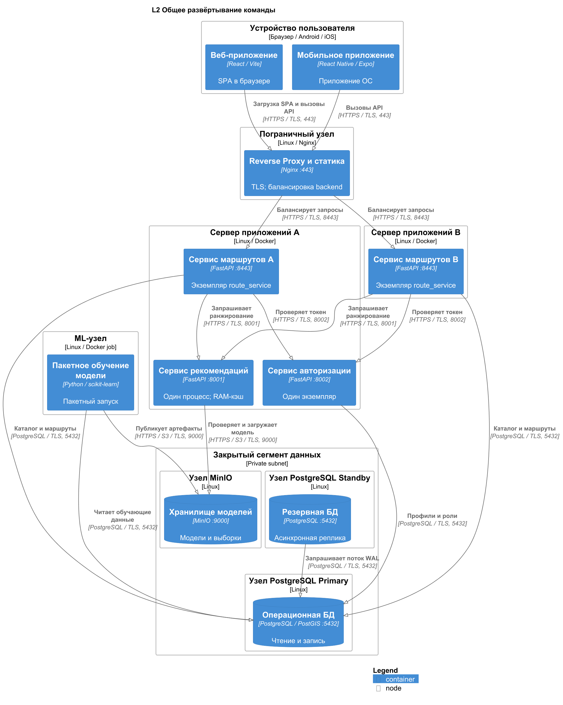

## Представления других частей

L3 каждого контейнера — отдельный вид, чтобы не смешивать границы процессов.

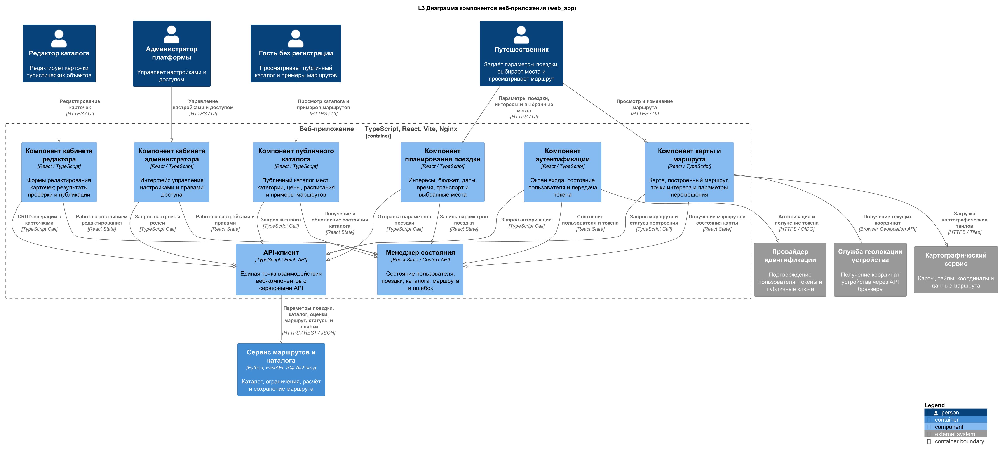

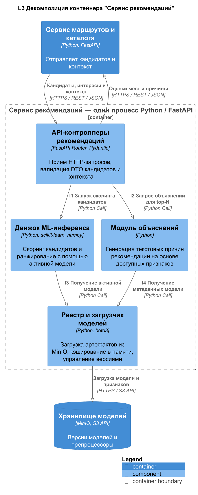

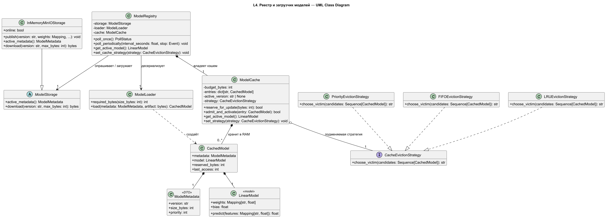

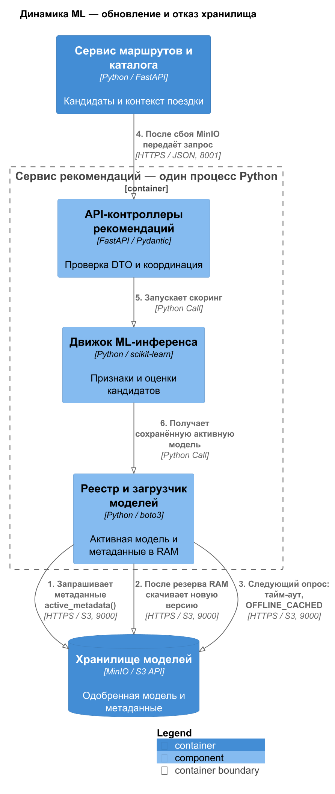

