# Дадонов Дмитрий — ML-часть ЛР №5

## Состав и проверка

Перенесены недостающие локальные схемы ЛР №4 в актуальный каталог репозитория. Все самостоятельные `.puml` в `lab5` автоматически обнаруживаются `scripts/validate_lab5.py` и включаются в существующую CI-сборку. Исходники, PNG и SVG хранятся рядом.

Сохранены PlantUML 1.2025.2, C4-PlantUML 2.12.0, Smetana и dpi 180 для C4. Относительные include используют общий `vendor` без сетевого `master`. UML L4 сохраняет исходное оформление. Для проверки и рендера из корня: `python scripts/validate_lab5.py --jar /path/to/plantuml-1.2025.2.jar --render`.

## Локальные и соответствующие общие представления

Каждая локальная схема идёт перед общей. L3 и L4 раскрывают конкретный ML-контейнер/компонент; общий комплект не превращает их в дополнительные микросервисы. Исторические `L1_integrated`/`L2_integrated` рядом с ML-исходниками сохраняются как материалы ЛР1; актуальные общие виды находятся в `../../integrated`.

### Ландшафт L0

Локальная схема:

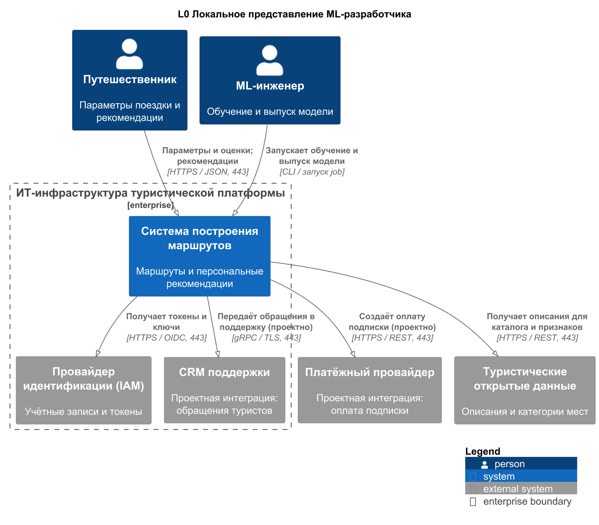

Соответствующее представление общего комплекта:

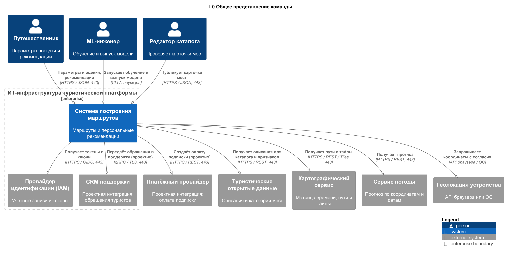

### Контекст L1

Локальная схема:

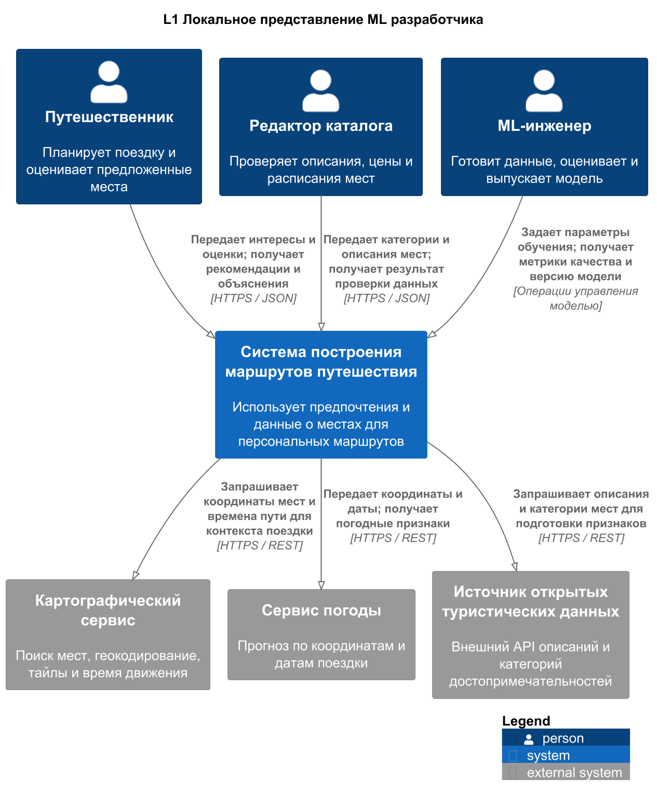

Соответствующее представление общего комплекта:

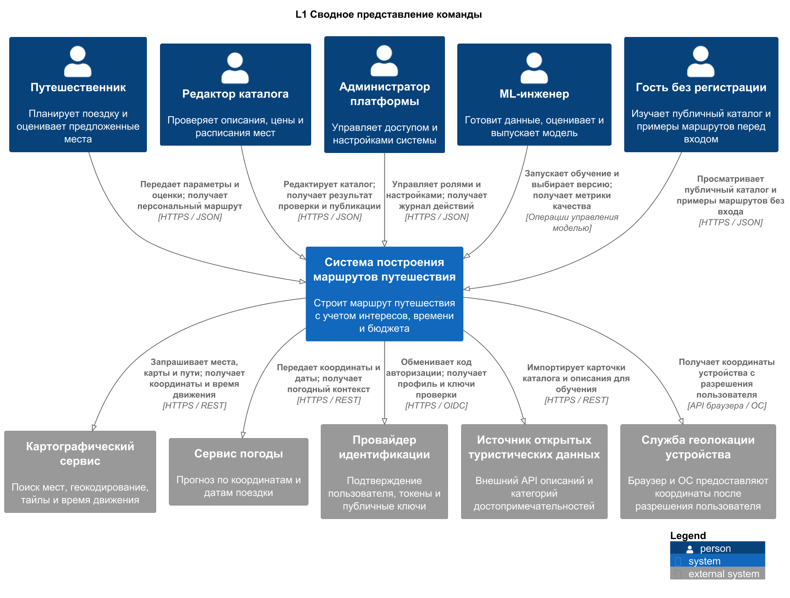

### Контейнеры L2

Локальная схема:

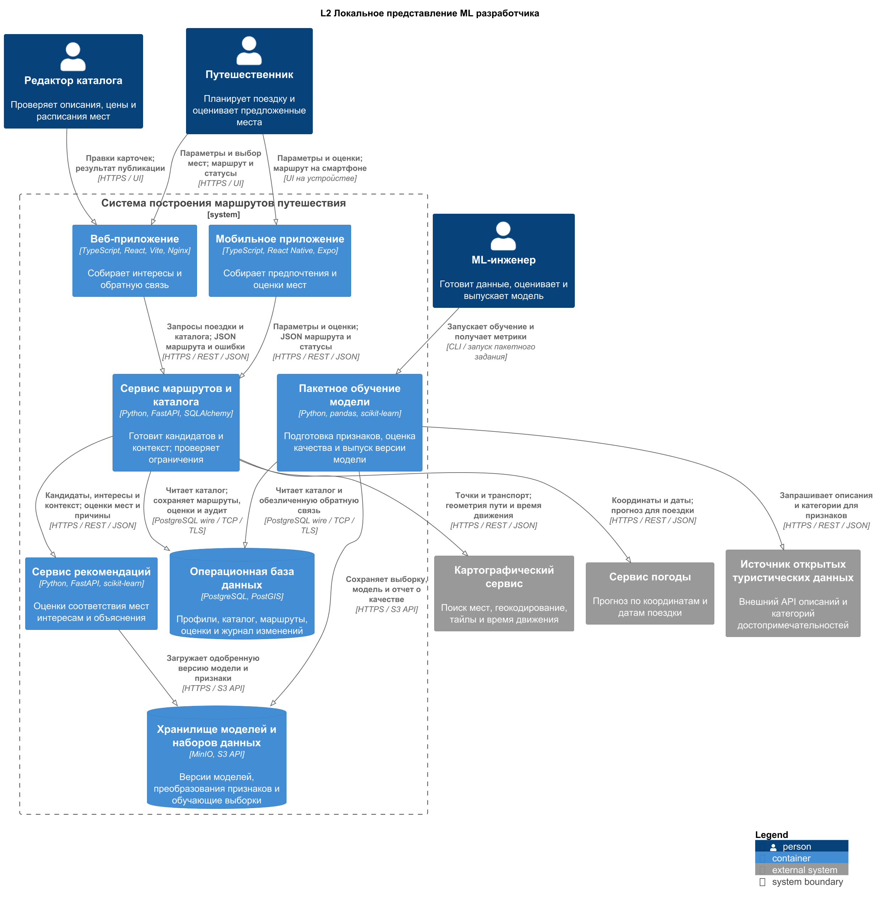

Соответствующее представление общего комплекта:

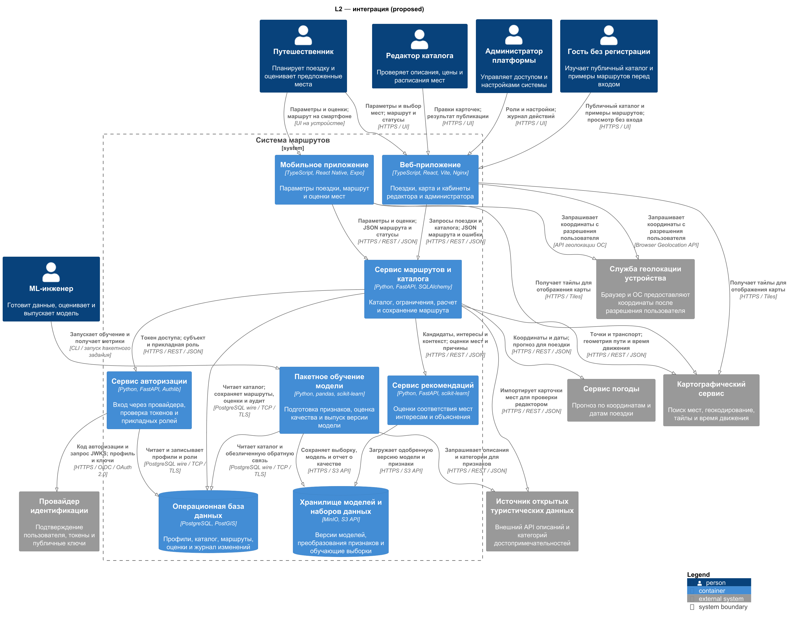

### Компоненты рекомендаций L3

Локальная схема:

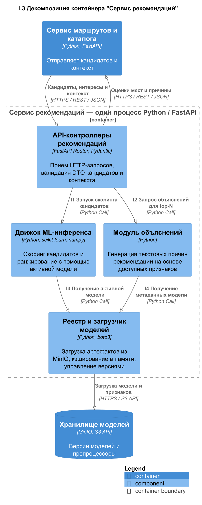

Соответствующее представление общего комплекта:

### Реестр моделей L4

Локальная схема:

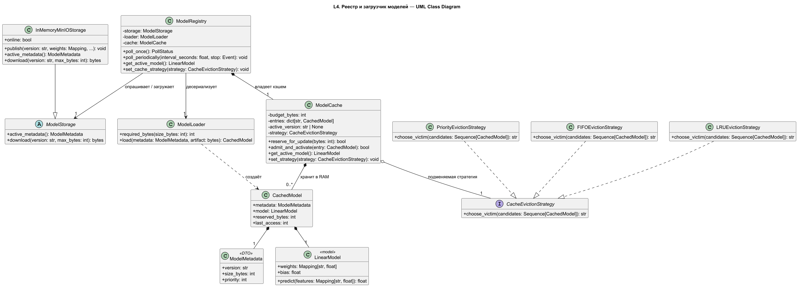

Соответствующее представление общего комплекта:

### Динамика запроса рекомендаций

Локальная схема:

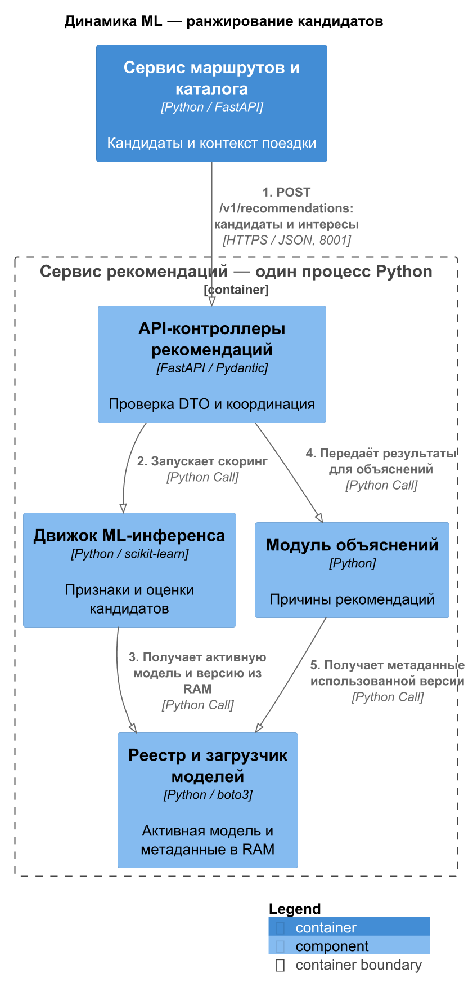

Соответствующее представление общего комплекта:

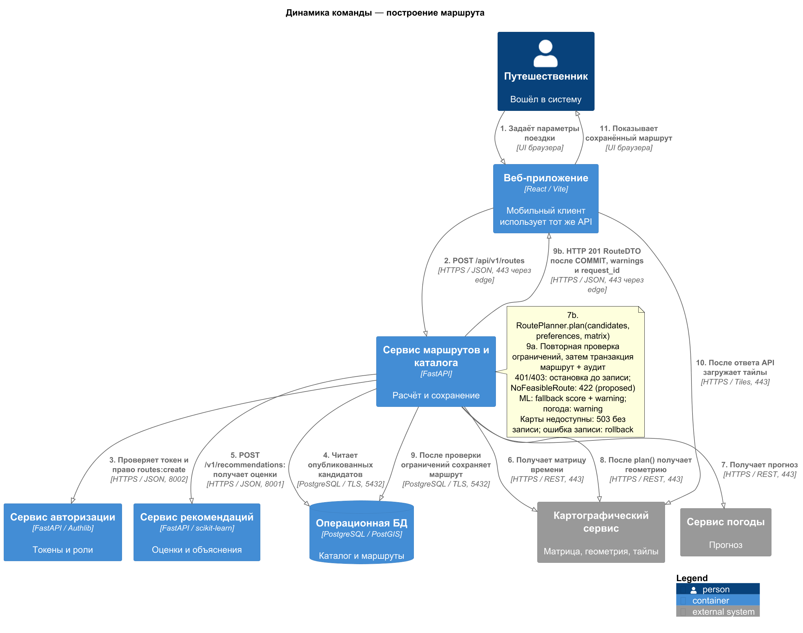

### Развёртывание ML

Локальная схема:

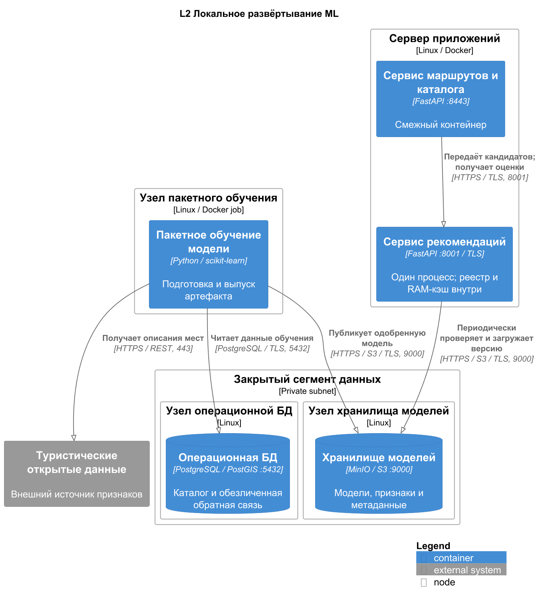

Соответствующее представление общего комплекта:

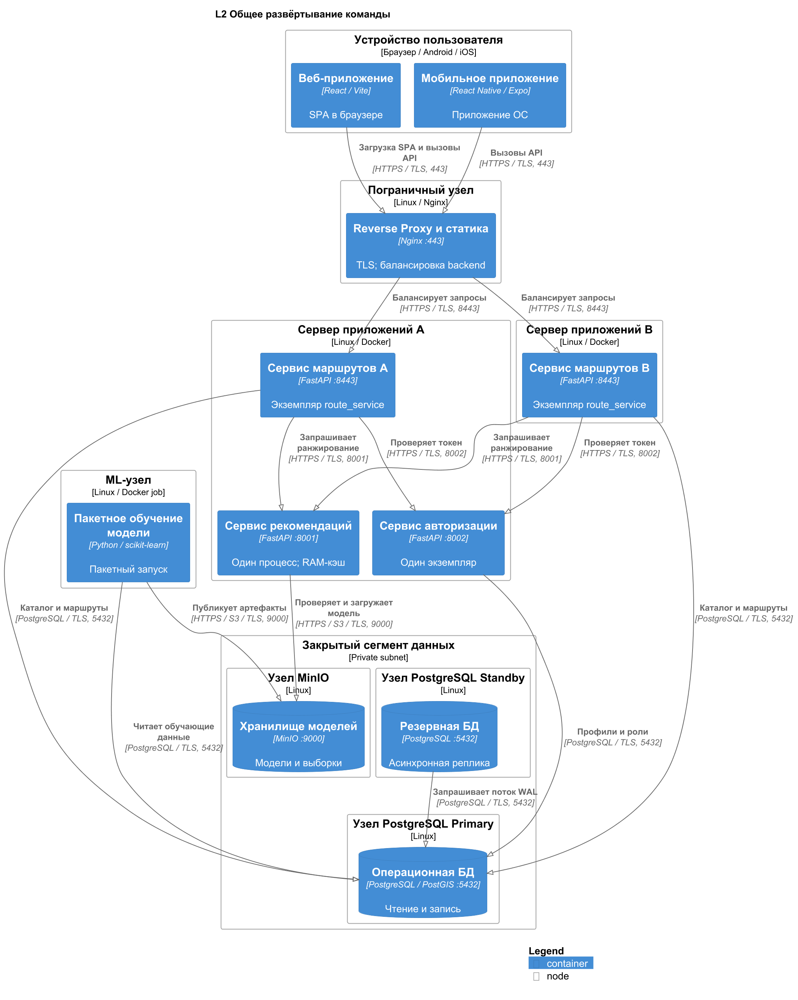

### Обновление модели и отказ MinIO

Локальный дополнительный сценарий:

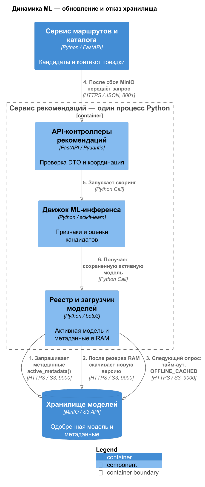

Соответствующая схема общего комплекта:

## Контракт и ограничения ML

- Backend передаёт кандидатов, интересы и контекст; получает ID, оценки, объяснения и версию модели. `POST /v1/recommendations`, HTTPS/JSON, TCP 8001 — проектный сетевой контракт; точные DTO ещё требуют совместного подтверждения.
- Четыре L3-компонента выполняются в одном Python-процессе. ModelCache остаётся классом внутри реестра.
- Обновление модели фоновое: метаданные → резерв квоты → загрузка/проверка → активация. На каждый запрос скачивание не выполняется.
- При недоступном MinIO работает ранее загруженная модель; холодный процесс без модели не готов к скорингу. Активная модель не вытесняется ради обновления.
- Ограничение памяти — логическая квота, а не контроль всего RSS. Реальный S3-клиент, конкурентная активация и мониторинг RAM прототипом не подтверждены.
- `code/model_registry.py` и `code/demo.py` не менялись в этом дополнении; демонстрация использует эмулятор MinIO.

## Вопросы для ревью тимлида

Число ML-процессов/реплик (HA-02), transport DTO и fallback скоринга остаются проектными решениями. Добавление схем не означает командного утверждения, работающего HTTP API или реально настроенного TLS. Техническая проверка кода и изображений не заменяет независимое ревью.

Этот документ — технические материалы индивидуальной части ЛР5; итоговый Word-отчёт оформляется после ревью и фиксации реальных ссылок PR/CI. Факт удалённой сборки проверяется на конкретном коммите в Actions.

## Выполненная локальная проверка

Проверка синтаксиса, policy lint и генерация PNG/SVG для всех 35 самостоятельных схем `lab5` завершились успешно; 12 backend-тестов и демонстрации ML/frontend завершились с кодом 0. Сводка — `validation/local_checks.json`. Это локальная проверка текущего дополнения; статус удалённой CI проверяется отдельно на коммите ветки.
